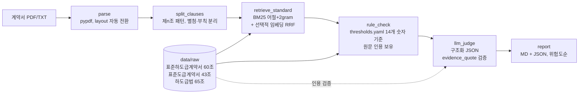

# 건설 하도급 계약 검토 보조 에이전트

> 하도급 계약서(PDF)를 **공정위 표준하도급계약서 · 국토부 표준도급계약서 · 하도급법**과 조항별로 대조해서,
> 수급사업자에게 **불리하거나 표준에서 벗어난 조항**을 **원문 근거 인용과 함께** 찾아내는 LangGraph 파이프라인.
> 공개 자료만으로 만든 개인 포트폴리오 프로젝트이며, 성능은 `make eval`의 측정값으로 증명한다.
>
> ⚠️ 법률 자문이 아닌 **검토 보조 도구**입니다. 모든 리포트에 같은 고지가 들어갑니다.

## 1. 문제

- 원청의 계약 검토 담당자는 하도급 계약서를 받으면 표준계약서·하도급법과 **조항마다 사람이 대조**해야 한다. 60개 조항 × 기준 문서 3종.
- 그중 상당수는 "60일이 90일로 바뀌었다"처럼 **숫자만 보면 되는 항목**인데도 LLM에 통째로 맡기면 근거 없이 그럴듯한 지적(환각)이 섞인다.
- 이 프로젝트는 (1) 조항 단위로 쪼개고, (2) 숫자형 항목은 **결정적 규칙**으로, 나머지는 LLM으로 판정하되, (3) LLM의 근거 인용이 **기준 문서에 실제로 있는 문장인지 코드로 검증**해서 환각 지적을 버린다.

## 2. 아키텍처



| 설정 | 조항 분할 | 검색 | 규칙 레이어 | 근거 검증 | 설명 |
|---|---|---|---|---|---|
| `baseline` | ✗ | ✗ | ✗ | ✗ | 계약서 전체를 LLM 한 번에 넣고 "불리한 조항 찾아줘" |
| `v1` | ✓ | BM25 | ✗ | ✗ | 조항별 LLM 판정 |
| `v2` | ✓ | BM25(+임베딩) | ✓ | ✓ | 규칙 우선 + LLM 인용 검증 |

핵심 설계 결정:
- **법령 수치는 기억으로 쓰지 않는다.** 규칙 기준값 14개는 전부 `data/thresholds.yaml`에 원문 인용과 함께 있고, `tests/test_thresholds.py`가 인용이 해당 조항 본문에 실제로 있는지 검증한다. 원문에 숫자가 없는 지체상금 요율·하자담보 기간 상한은 `TODO(source-needed)`로 두고 규칙에서 제외했다.
- **LLM 인용 검증**: `evidence_quote`는 LLM이 지목한 표준 조항 본문의 부분문자열(공백 무시)이어야 한다. 아니면 그 finding은 버리고 개수를 리포트에 적는다.
- **규칙 판정 우선**: 같은 조항·카테고리를 규칙과 LLM이 둘 다 지적하면 규칙 결과를 쓴다.
- `FakeLLM`(표준 top-1과 문장 diff) 덕분에 **API 키 없이 `make test` 47개가 통과**한다.

## 3. 평가

### 3.1 평가셋 (합성, `data/synthetic/`)
- 표준하도급계약서 본문을 바탕으로 `scripts/make_synthetic.py`가 **시드 고정**으로 생성 (실제 계약서 아님).
- 계약서 3개 × 변형 8개 = **라벨 24개**, 7개 카테고리. 변형 카탈로그 25종(기한 연장, 비율 변경, 면제 사유 삭제, 일방 권리화, 비용 전가 조항 추가 등).
- 검색이 조 번호만 보고 맞히지 못하게 정상 조항 10개를 삭제·재번호하고 당사자 명칭을 갑/을로 바꿨다. 정상 조항 42개/계약서가 오탐(false positive) 측정용.

### 3.2 지표
| 지표 | 정의 |
|---|---|
| Recall | 주입한 변형 중 잡아낸 비율 (`contract_id, clause_id, category` 일치) |
| Precision | 지적한 finding 중 라벨과 일치한 비율 |
| Citation accuracy | TP 중 `standard_ref`가 정답 표준 조항을 가리킨 비율 |
| Retrieval hit@3 | 변형 조항의 정답 표준 조항이 검색 top-3에 든 비율 |
| 처리 시간·토큰 | 계약서당 평균 |

### 3.3 결과

**검색 (BM25 단독, 150개 조항 질의)**: hit@1 0.98 / hit@3 **1.00**, 제목을 지운 hard 설정에서도 hit@3 1.00, 질의당 8 ms.
→ 합성 계약서가 표준 원문을 거의 그대로 복사하기 때문에 나온 값이다. 실제 계약서는 문장을 바꿔 쓰므로 이보다 낮을 것이다.

**파이프라인 비교: 실제 LLM `claude-sonnet-5-5`, 합성 계약서 3개, 라벨 24개 (2026-11-08)**

| config | Recall | Precision | Citation | hit@3 | Risk match | 계약서당 입력 토큰 | 계약서당 출력 토큰 |
|---|---|---|---|---|---|---|---|
| baseline (전체 1회 호출) | 0.92 (22/24) | 0.81 (22/27) | 0.00 | – | **0.82** | **42,887** | **8,311** |
| v1 (조항 분할 + BM25 + LLM) | 0.96 (23/24) | 0.85 (23/27) | 1.00 | 1.00 | 0.57 | 251,952 | 14,341 |
| v2 (+ 규칙 레이어 + 근거 검증) | **1.00 (24/24)** | **0.89 (24/27)** | **1.00** | 1.00 | 0.62 | 252,158 | 12,826 |

무엇을 바꿨더니 무엇이 변했나:
- **baseline → v1 (조항 분할 + 검색):** recall +1건, 오탐 5 → 4건. 근거 조항이 표준 원문으로 고정되어 citation 0.00 → 1.00.
  대가로 **입력 토큰이 약 5.9배**(조항마다 표준 조항 top-3를 함께 넣기 때문).
- **v1 → v2 (규칙 레이어):** v1이 놓친 1건("증액분 지급 기한 15일 → 60일")을 규칙이 숫자로 잡아 recall 1.00.
  같은 조항을 v1은 `payment_deadline`으로 잘못 분류해 오탐이었는데, v2는 규칙 결과를 프롬프트에 넣어 중복 보고를 막아 오탐도 사라짐.
- **근거 검증은 이번 평가에서 효과 0:** Sonnet이 낸 인용은 전부 원문에 실제로 있어서 버린 finding이 0건이다. v2의 개선은 **전부 규칙 레이어에서** 나왔다.

반드시 같이 적어야 하는 한계:
- **표본이 작다.** 라벨 24개라 1건이 recall 4.2%p다. v1 → v2 차이는 1건이다.
- **남은 오탐 3건(v2)은 모델 오류가 아니라 평가셋 생성기 버그다.** 조항을 재번호하면서 본문 속 조문 참조("제11조에 따른 서면")를 고치지 않아, 계약서마다 제11조가 자기 자신을 인용하게 됐다. LLM은 이 실제 불일치를 지적했다. 평가셋은 숫자를 위해 고치지 않았고, 수정판은 별도 버전으로 비교할 예정이다.
- **baseline citation 0.00은 원인을 아직 확인하지 못했다.** baseline은 표준 원문을 받지 않아서 조문 번호를 기억에 의존하는데, 결과 파일에 finding 원문이 저장되지 않았다(하네스 수정 완료, 재실행 필요).
- **위험도 판정(risk match)은 baseline이 가장 좋다(0.82).** 조항별 판정은 위험도를 낮게 매기는 경향이 있고, 규칙은 법령 출처면 high로 올려 라벨(medium)과 어긋난다.
- **처리 시간은 비교할 수 없다.** 평가를 캐시를 켠 채 돌렸다. v1·v2는 같은 프롬프트가 많아 캐시 적중(v1 32/150, v2 141/150)이 생겨 시간이 실제보다 짧다. 캐시 없는 baseline만 유효(계약서당 53초).
- 비용(USD)은 단가를 기억으로 쓰지 않기 위해 기록하지 않았다. 토큰 수로 비교한다.

<details><summary>FakeLLM(결정적 diff 판정기) 결과: 하네스 동작 확인용, 성능 지표 아님</summary>

| config | recall | precision | citation | hit@3 | risk_match |
|---|---|---|---|---|---|
| baseline | 0.00 | – | – | – | – |
| v1 | 0.92 | 1.00 | 1.00 | 1.00 | 0.59 |
| v2 | 0.92 | 1.00 | 1.00 | 1.00 | 0.45 |
</details>

재현:
```bash
LLM_PROVIDER=anthropic ANTHROPIC_API_KEY=... bash scripts/run_real_eval.sh
```

## 4. 실행

```bash
make setup                      # .venv + 의존성
cp .env.example .env            # LLM_PROVIDER=fake|openai|anthropic, 키는 여기에만
make test                       # 키 없이 통과
make eval                       # v2 평가 → eval/results/
make run                        # Streamlit: PDF 업로드 → 리포트
docker build -t contract-review . && docker run -p 8501:8501 --env-file .env contract-review
```

실제 LLM 평가 팁: `LLM_CACHE=1`이면 같은 프롬프트 응답을 `.cache/llm/`에 저장해 재실행 비용이 0이 된다
(처리 시간 지표는 캐시를 끄고 잰다). 429/5xx는 `LLM_MAX_RETRIES`(기본 5)만큼 지수 백오프로 재시도하고,
그래도 실패한 호출은 그 조항만 빠지고 결과표에 "LLM 호출 실패" 수로 남는다.

CLI로 리포트 1건:
```bash
.venv/bin/python -c "from pathlib import Path; from contract_review.graph import Pipeline; from contract_review.nodes.report import write_report; o=Pipeline('v2').run('data/synthetic/synthetic_contract_01.txt'); print(write_report(o['report'], Path('outputs')))"
```

## 5. 알려진 한계

1. **합성 데이터의 한계**: 변형이 표준 원문의 문자열 치환이라 검색·diff가 실제보다 쉽다. 실제 계약서(문장 재작성, 특약 별지, 표 형식)에서의 recall은 측정되지 않았다.
2. **원문에 없는 기준값**: 지체상금 요율(국가계약법 시행규칙), 하자담보책임기간 상한(건설산업기본법 시행령)은 원문이 없어 규칙에서 뺐다. 이 카테고리는 LLM 판정에만 의존한다.
3. **HWP 직접 파싱 미지원**: 표준하도급계약서는 1회 변환한 txt를 쓴다. 스캔 PDF(OCR)도 비범위.
4. **근거 검증은 "인용이 실존하는가"만 본다**: 인용이 실제로 그 지적을 뒷받침하는지(관련성)는 검증하지 않는다.
   문장부호 차이(ㆍ/·, 「」/"", 전각 괄호)와 "…" 생략 인용은 허용한다 (`textnorm.py`).
5. **규칙 레이어는 문형이 표준과 같을 때만 숫자를 읽는다**: 문장을 통째로 바꿔 쓴 계약서면 규칙은 조용히 빠지고 LLM 이 판정한다.
   오탐은 늘지 않지만, 합성셋의 규칙 적중률(숫자형 변형 12/12)은 실제 계약서에서 낮아질 것이다.
6. 실제 LLM 평가는 모델 1개(claude-sonnet-5-5), 합성 계약서 3개, 1회 실행 결과다. 반복 실행에 따른 편차는 재지 않았다.

## 6. 다음 단계

- 평가셋 생성기의 조문 참조 재번호 버그 수정판으로 재평가 (현재판 결과와 나란히 기록)
- 캐시 끄고 처리 시간 재측정
- 국가계약법 시행규칙·건설산업기본법 시행령 원문 추가 → 지체상금·하자담보도 규칙 판정
- 실제 공개 계약서 샘플(예: 공공기관 공고 첨부) 몇 건으로 합성셋 밖 성능 점검
- 2차 사용자(중소 하도급 업체)용: "이 조항이 왜 불리한지" 쉬운 설명 모드

## 7. 레포 구조

```
src/contract_review/
  schemas.py        pydantic (Clause, RetrievedRef, RuleHit, Finding, ReviewReport, EvalCase)
  nodes/            parse · split_clauses · retrieve_standard · rule_check · llm_judge · report
  retrieval.py      BM25 + 선택적 임베딩(RRF)
  thresholds.py     data/thresholds.yaml 로더
  standards.py      기준 문서 로더 + 인용 검증
  llm.py            provider 팩토리, FakeLLM
  graph.py          LangGraph StateGraph (baseline/v1/v2)
  eval.py           평가 하네스, 비교표
data/raw/           공개 원문 (하도급법, 표준하도급계약서, 표준도급계약서)
data/thresholds.yaml 규칙 기준값 (원문 인용 포함)
data/synthetic/     합성 계약서 (SYNTHETIC)
eval/cases/         정답 라벨   eval/results/  평가 결과
scripts/            make_synthetic.py · inspect_raw.py
app/streamlit_app.py
docs/               SPEC.md · PLAN.md · raw_clauses.md     PROGRESS.md  진행 로그
```
