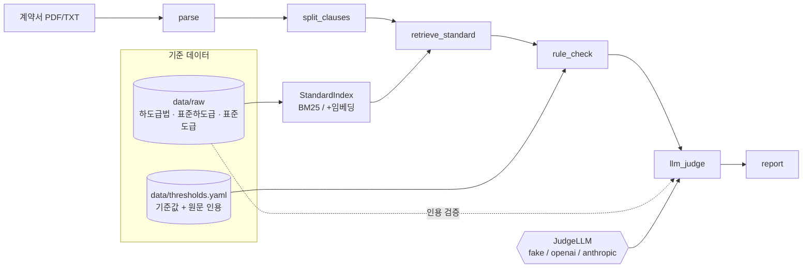

# P2. 설계

> **사후 작성 (2026-11-08).** 기술스택과 구조는 첫 프롬프트에서 대부분 정해져 내려왔다.
> 여기서는 **다른 후보와 비교해 왜 이게 맞는지(또는 아쉬운지)**를 사후에 정리한다. 면접 대비 문서이기도 하다.
> 상세 스키마와 판정 기준은 `docs/SPEC.md` 가 원본이고, 이 문서는 결정과 이유를 담는다.

## 1. 기술스택 선정 (ADR)

| # | 영역 | 후보 | 선택 | 이유 | 포기한 것 (트레이드오프) |
|---|---|---|---|---|---|
| ADR-01 | 파이프라인 오케스트레이션 | ① 순수 Python 함수 연결 ② LangChain LCEL ③ **LangGraph** ④ CrewAI 등 멀티 에이전트 | LangGraph `StateGraph` | 노드별 입출력이 명확하고, baseline/v1/v2 를 **그래프 경로 분기**로 같은 코드에서 비교할 수 있다. 나중에 "근거 검증 실패 시 재판정" 같은 조건부 루프를 넣기 쉽다. 채용 공고의 에이전트 스택과도 맞다 | **솔직히 지금 구조는 직선형**이라 ①로도 충분하다. LangGraph 의 상태 관리·조건부 엣지 장점을 아직 다 쓰지 않는다. 멀티 에이전트(④)는 디버깅·평가가 어려워 비범위로 뺐다 |
| ADR-02 | 조항 분할 | ① LLM 에게 분할 맡기기 ② 고정 길이 청크 ③ **"제n조" 정규식** | 정규식 + 예외 처리 | 한국 계약서·법령은 "제n조(제목)" 구조가 정해져 있어 규칙이 정확하고 비용이 0이다. 조항 ID 가 평가 매칭 키가 된다 | 형식이 다른 문서(조항 번호 없는 특약 별지, 표)는 놓친다. 실제 원문을 보며 별첨·부칙·장래 시행 조문 처리를 추가했다 |
| ADR-03 | 검색 | ① 임베딩 단독 ② **BM25 (어절 + 한글 2-gram)** ③ 하이브리드 (BM25 + 임베딩, RRF) | BM25 기본, 키가 있으면 하이브리드 | 계약 조항은 "지체상금", "하자보수보증금" 같은 **전문 용어가 그대로 겹쳐서** 단어 기반 검색이 강하다. 형태소 분석기 없이 2-gram 으로 조사 변화를 흡수했다. 임베딩 없이도 돌아가야 테스트가 키 없이 통과한다 | 문장을 완전히 바꿔 쓴 계약서에는 약하다. 하이브리드는 키가 없어 **효과 미측정** |
| ADR-04 | 벡터 저장소 | ① FAISS ② **chromadb (인메모리)** ③ 벡터 DB 서버 | chromadb `EphemeralClient` | 허용 의존성 목록에 있고, 기준 조항 168개라 메모리로 충분하다. DB 서버는 비범위 | 영속 저장 없음 (실행마다 재색인, 168개라 문제없음) |
| ADR-05 | 숫자 판정 | ① LLM 에게 맡기기 ② **결정적 규칙 레이어** | 규칙: `data/thresholds.yaml` 의 원문 인용에서 숫자 자리를 패턴으로 바꿔 계약서 숫자를 읽고 비교 | "60일 → 90일"은 LLM 이 틀릴 이유가 없는 문제를 확률적으로 풀게 하지 않는다. **기준값마다 원문 인용이 붙어 있어** 근거가 자동으로 생긴다 | 문형이 표준과 다르면 숫자를 못 읽고 LLM 에 넘긴다 (오탐은 늘지 않지만 실제 계약서에선 적중률이 낮아질 것) |
| ADR-06 | 환각 대응 | ① 프롬프트로 "지어내지 마" ② 별도 LLM 검증자 ③ **코드로 인용 존재 검증** | ③ 부분문자열 검증 (공백·문장부호 정규화) | 결정적이고 비용이 0이며 테스트할 수 있다. 버린 개수를 리포트에 남겨 투명하다 | **"인용이 실제로 지적을 뒷받침하는가"(관련성)는 검증하지 않는다.** 그건 ② 같은 추가 단계가 필요하다 |
| ADR-07 | LLM provider | ① 한 회사에 고정 ② **프로토콜 + 팩토리 (fake/openai/anthropic)** | `JudgeLLM` 프로토콜, `FakeLLM` 기본값 | 키 없이 테스트·데모가 가능하고(NFR-03), 모델 비교도 설정만 바꾸면 된다 | FakeLLM 은 문장 차이만 보는 대역이라 **그 숫자는 성능 지표가 아니다** |
| ADR-08 | 평가 데이터 | ① 실제 계약서 수집 ② LLM 으로 계약서 생성 ③ **표준계약서에 결정적 변형 주입** | ③ 변형 카탈로그 25종, 시드 고정 | 정답 라벨이 **100% 정확**하고 재현 가능하다. 실제 계약서는 구하기 어렵고 라벨링 비용이 크다. ②는 라벨이 부정확해진다 | 원문 복사본이라 **실제보다 쉽다** (hit@3 1.00 이 그 증거). README 한계 1번으로 명시 |
| ADR-09 | HWP 원문 처리 | ① LibreOffice 변환 ② **pyhwp 로 1회 변환 후 txt 커밋** ③ 의존성에 HWP 파서 추가 | ② | LibreOffice 는 이 환경에서 HWP 를 열지 못했다(실제 시도). 원문은 바뀌지 않으므로 1회 변환이면 된다. 허용 목록 밖 의존성을 늘리지 않는다 | 사용자가 HWP 를 직접 올리는 기능은 없다 (FR-17 Won't) |
| ADR-10 | UI | ① FastAPI + React ② **Streamlit** | Streamlit | 화면 꾸미기는 비범위이고, 하루 안에 업로드 → 리포트 흐름을 만들 수 있다 | 다중 사용자·인증·커스텀 디자인 불가 |
| ADR-11 | 설정·스키마 | dict 로 주고받기 vs **pydantic** | pydantic v2 | 노드 경계, LLM 응답, 평가 라벨을 타입으로 검증한다. 잘못된 카테고리·위험도 값은 바로 걸러진다 | 모델 정의 코드가 늘어난다 |

설치 버전 (2026-11-08 기준 `.venv`): langgraph 1.2.19, langchain-core 1.7.4, langchain-openai 1.7.3, langchain-anthropic 1.7.9, chromadb 1.5.9, rank-bm25 0.2.2, pypdf 6.21.4, pydantic 2.14.2, streamlit 1.66.1. `pyproject.toml` 은 버전을 고정하지 않는다 (개선 여지).

## 2. 아키텍처

**설정별 경로** (같은 그래프 코드에서 분기, `graph.py`)
| config | 경로 | 비교 목적 |
|---|---|---|
| baseline | parse → judge_whole → report | "계약서 통째로 LLM" 기준선 |
| v1 | parse → split → retrieve(BM25) → judge(검증 없음) → report | 조항 분할 + 검색의 효과 |
| v2 | parse → split → retrieve(BM25/하이브리드) → rule_check → judge(검증 있음) → report | 규칙 + 근거 검증의 효과 |

## 3. 컴포넌트
| 컴포넌트 | 파일 | 책임 | 입력 → 출력 | 관련 요구사항 |
|---|---|---|---|---|
| parse | `nodes/parse.py` | PDF/TXT 텍스트 추출, 띄어쓰기 소실 시 layout 모드 재추출, 머리글 제거 | 경로 → `ParsedDocument` | FR-01 |
| split_clauses | `nodes/split_clauses.py` | 조항 분할, 별첨·부칙·장래 시행 분리 | `ParsedDocument` → `list[Clause]` | FR-02, FR-03 |
| StandardIndex | `retrieval.py` | BM25 색인, 선택적 임베딩 + RRF | 질의 → `list[RetrievedRef]` | FR-04, FR-05 |
| rule_check | `nodes/rule_check.py` | 기준값 패턴으로 숫자 비교 | `Clause` + refs → `list[RuleHit]` | FR-06, NFR-01 |
| llm_judge | `nodes/llm_judge.py` | 프롬프트, JSON 복구 파싱, 인용 검증, 중복 제거 | `Clause` + refs + hits → `JudgeResult` | FR-07, FR-08, FR-09 |
| textnorm | `textnorm.py` | 비교용 정규화 (공백·문장부호·NFKC) | 문자열 → 문자열 | FR-08 |
| llm | `llm.py` | provider 팩토리, FakeLLM, 재시도, 캐시 | 프롬프트 → (텍스트, 토큰) | FR-11, NFR-08 |
| report | `nodes/report.py` | MD/JSON 리포트 | `ReviewReport` → 파일 | FR-10, NFR-02 |
| graph | `graph.py` | LangGraph 조립, config 분기 | 경로 → `ReviewState` | FR-13 |
| eval | `eval.py`, `eval_retrieval.py` | 지표 계산, 비교표 | 합성셋 → `eval/results/*` | FR-13, NFR-07 |
| make_synthetic | `scripts/make_synthetic.py` | 변형 주입 평가셋 생성 | 표준 원문 → 계약서 + 라벨 | FR-12, NFR-04 |
| UI | `app/streamlit_app.py` | 업로드 → 리포트 | 파일 → 화면 | FR-14 |

## 4. 데이터 모델
`src/contract_review/schemas.py` (pydantic). 핵심만:

| 모델 | 주요 필드 | 쓰는 곳 |
|---|---|---|
| `Clause` | doc_id, clause_id, title, text, section | 분할 결과, 검색 질의 |
| `RetrievedRef` | source_doc, clause_id, title, text, score | 검색 결과 |
| `RuleHit` | category, risk_level, observed_value, threshold_value, threshold_source, evidence_quote | 규칙 판정 |
| `Finding` | clause_id, category, risk_level, contract_text, standard_ref, deviation_summary, evidence_quote, source(rule/llm) | 최종 지적 |
| `ReviewReport` | contract_id, config, findings, stats, disclaimer | 리포트 |
| `EvalCase` | contract_id, clause_id, category, expected_risk, injected_change, standard_clause_id | 평가 라벨 |

기준값 파일 `data/thresholds.yaml`: `id, category, worse_if(greater/less/none), value, unit, source_doc, clause_id, quote, standard_ref`

## 5. 인터페이스
| 인터페이스 | 형식 |
|---|---|
| CLI | `make test / lint / eval / eval-baseline / run`, `python -m contract_review.eval --config v2 --llm anthropic`, `--compare` |
| 환경변수 | `LLM_PROVIDER`, `OPENAI_API_KEY`, `ANTHROPIC_API_KEY`, `EMBEDDING_PROVIDER`, `LLM_CACHE`, `LLM_MAX_RETRIES`, `LLM_MAX_TOKENS`, `OPENAI_MODEL`, `ANTHROPIC_MODEL`, `PRICE_IN_PER_1M`, `PRICE_OUT_PER_1M` |
| LLM 출력 계약 | JSON 배열, 원소 `{clause_id, category, risk_level, standard_ref, deviation_summary, evidence_quote}` |
| 평가 산출물 | `eval/results/{날짜}_{config}_{llm}.md/.json`, `{날짜}_compare.md` |

## 6. 테스트·평가 계획
| 대상 | 방법 | 통과 기준 | 관련 요구사항 |
|---|---|---|---|
| 파싱·분할 | 실제 원문 3종 단위 테스트 | 조항 수 60 / 43 / ≥60, 형식 변형 인식 | FR-01~03 |
| 기준값 출처 | 인용이 원문 조항에 있는지 전수 검사 | 15개 전부 통과 | NFR-01 |
| 검색 | 합성셋 150조항 hit@k | 변형 조항 hit@3 ≥ 0.8 | FR-04 |
| 규칙 | 숫자 바꾼 조항 / 원문 그대로 조항 | 바뀐 것만 지적 | FR-06 |
| 근거 검증 | 날조 인용 vs 문장부호만 다른 진짜 인용 | 날조만 폐기 | FR-08 |
| E2E | FakeLLM 으로 v2·baseline 그래프 실행 | 끝까지 돌고 고지 포함 | FR-10, FR-13 |
| **성능 비교 (핵심)** | 실제 LLM 으로 baseline/v1/v2 × 합성 계약서 3개 | baseline 대비 개선을 숫자로 기록 (나빠져도 기록) | FR-13 **← 미실행** |
| 실제 문서 일반화 | 공개 계약서 샘플 | precision·recall 별도 기록 | 01_brief 가정 2·3 **← 미계획 (데이터 없음)** |

## 7. 사후 회고: 설계에서 아쉬운 점
- **ADR-01:** LangGraph 를 쓰지만 지금은 직선형이다. "근거 검증 실패 → 재판정" 루프를 넣으면 LangGraph 를 쓸 이유가 분명해진다.
- **ADR-08:** 합성셋이 쉬워서 검색(hit@3 = 1.00)이 비교에서 변별력이 없다. 문장을 다시 쓴 어려운 변형을 넣은 평가셋이 필요하다.
- **의존성 버전 고정 없음:** 재현성을 위해 lock 파일이나 버전 상한이 필요하다.
